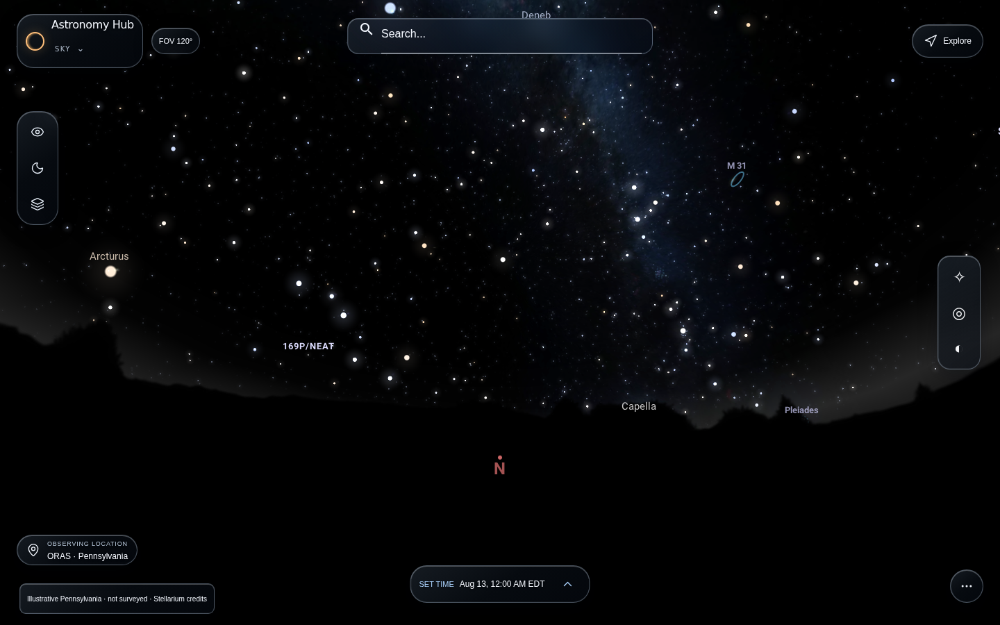
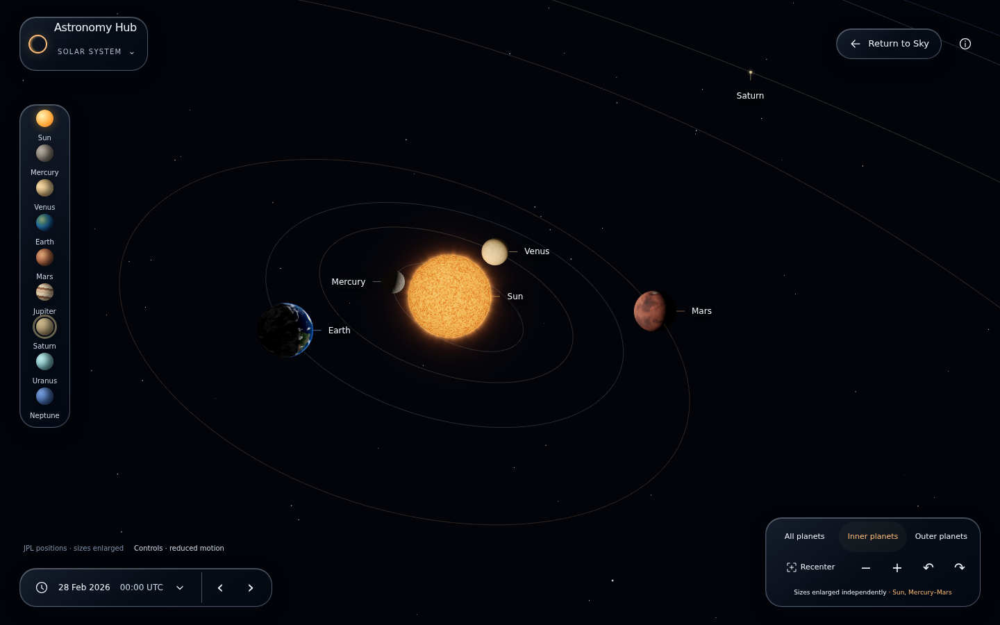
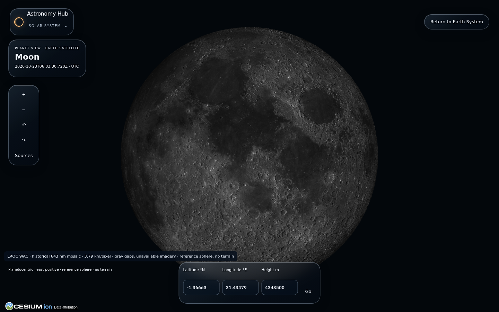
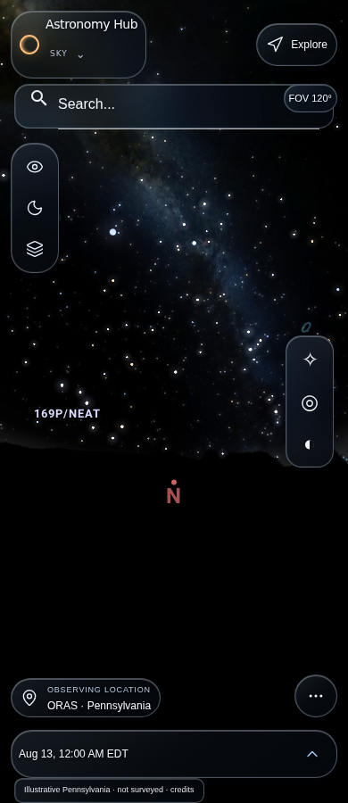
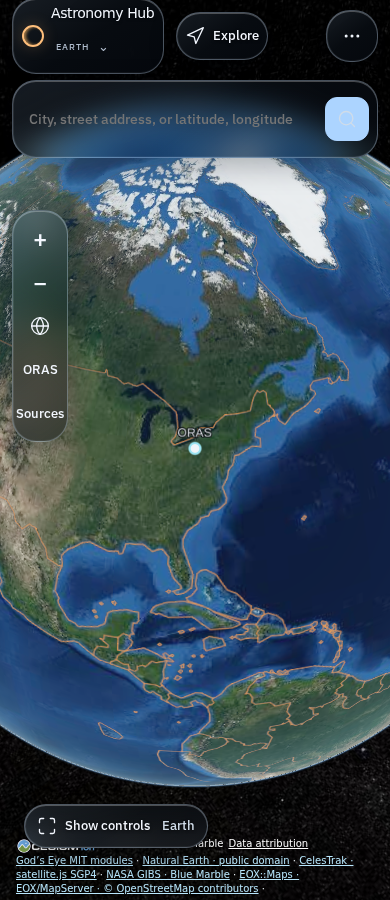
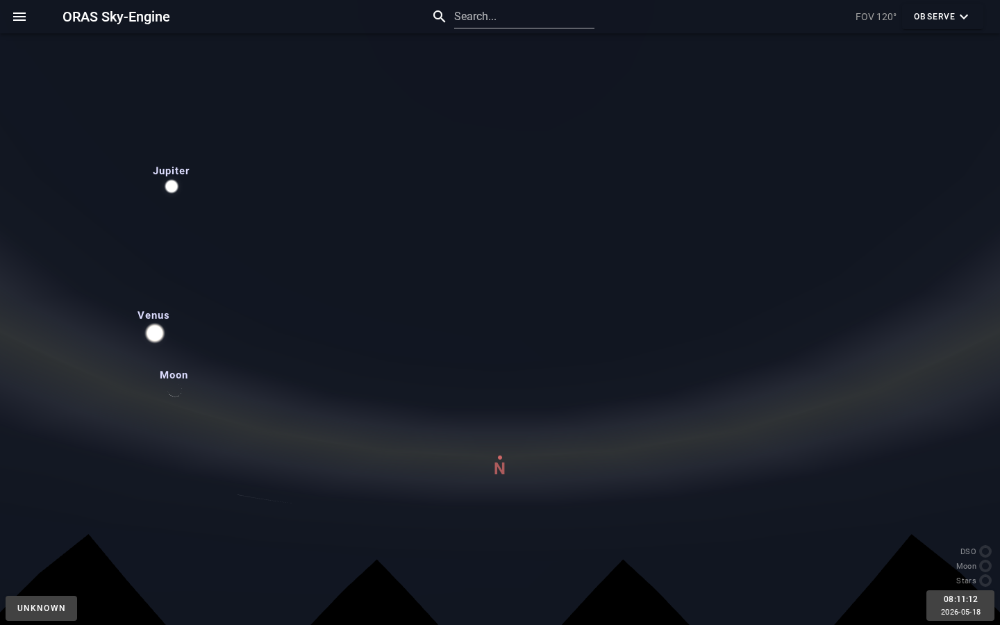

# Astronomy Hub

**Explore the night sky. Find what matters tonight. Go farther.**

Astronomy Hub is an open-source astronomy exploration project built around a simple question: **“What is above me right now, and what should I pay attention to?”** It brings observer-aware astronomy tools, native sky rendering, and an evolving Earth/Solar System experience into one workspace.

> **Active development — not a production release.** The featured screenshots below are **real browser captures from open, unmerged development PRs**, not mockups or screenshots of the current `main` build. The cinematic UI and planetary views are candidates awaiting final owner review, merge, and deployment. [See what is actually on `main`](#current-status).

## A look inside Astronomy Hub

### Explore the sky

[](docs/images/astronomy-hub-sky-desktop.png)

*Sky desktop preview — native Stellarium scene, astronomy search, observing location, and contextual tools. [Candidate PR #91](https://github.com/Shadowgar/Astronomy-Hub/pull/91); not merged.*

### Explore farther

| Solar System preview | Moon surface preview |
| :---: | :---: |
| [](docs/images/astronomy-hub-solar-desktop.png) | [](docs/images/astronomy-hub-moon-desktop.png) |
| Cinematic Solar exploration · [PR #91](https://github.com/Shadowgar/Astronomy-Hub/pull/91) | Source-qualified Moon globe · [PR #95](https://github.com/Shadowgar/Astronomy-Hub/pull/95) |

### On a smaller screen

<p align="center">
  <a href="docs/images/astronomy-hub-sky-mobile.png"></a>
  &nbsp;&nbsp;&nbsp;
  <a href="docs/images/astronomy-hub-earth-mobile.png"></a>
</p>

<p align="center"><em>Sky and Earth mobile-viewport previews from <a href="https://github.com/Shadowgar/Astronomy-Hub/pull/91">PR #91</a>. Browser-emulated viewports, not photographs of physical devices.</em></p>

These are **actual application screenshots from tested development branches**. They do not mean those features are released or available on `main`. The [screenshot provenance record](docs/images/README.md) lists source commits and original evidence files; no conceptual artwork is presented as a functioning feature.

## What it does

- **Observe the sky:** Use a contained Stellarium Web / Stellarium Web Engine runtime for sky rendering, object selection, camera control, and astronomy source data.
- **Understand observing conditions and targets:** Work with location, time, object information, and focused **Observe** and **Tonight** experiences.
- **Explore Earth:** Move into an independently rendered Cesium Earth context, with source-aware imagery and explicit provider/coverage limitations.
- **Connect specialized views:** The Hub owns navigation and shared context while the Sky and Earth engines retain their own rendering and scientific responsibilities.
- **Develop toward a unified explorer:** Solar System navigation, detailed Moon exploration, and a cohesive cinematic interface are under active review, **not established features on `main`**.

Astronomy Hub favors traceable scientific sources and honest unavailable states over invented celestial positions, unrealistic map-coverage claims, or a visual demo that pretends to be a finished release.

## Current status

| Area | Merged foundation on `main` | Work in separate review PRs |
| --- | --- | --- |
| **Sky** | Contained Stellarium runtime and bounded Hub Sky integration | Refined native observing controls and cinematic Sky interface |
| **Earth** | Hub-owned Cesium Earth viewer with qualified regional imagery and Sky/Earth integration | Search, imagery/cache qualification, and revised contextual Earth presentation |
| **Solar System / Moon** | Documented architecture and qualified source components | Cinematic Solar and native Moon/planetary-system candidates; **not merged** |
| **Observe / Tonight** | Focused routes and astronomy workflows | Further integration into a shared contextual experience |

The existing bounded local qualification is **not** proof of global imagery coverage, deployment readiness, finished planetary travel, or owner-approved final visual design. Review the [feature tracker](docs/features/FEATURE_TRACKER.md), [implementation evidence](docs/validation/UNIFIED_WORKSPACE_IMPLEMENTATION_EVIDENCE.md), and [product vision](docs/product/PRODUCT_VISION.md) for the authoritative distinctions.

<details>
<summary>View an earlier captured Sky runtime from the merged development foundation</summary>

[](docs/images/astronomy-hub-sky-historical.png)

*Historical local capture already tracked on `main`; not a claim of the current deployed appearance.*

</details>

## How it works

```text
Astronomy Hub — navigation, observer/time context, discovery and details
        ├── Sky: Stellarium Web / Stellarium Web Engine
        ├── Earth: independent Cesium runtime
        └── Observe / Tonight: focused astronomy workflows

FastAPI (Python) · React/Vite · PostgreSQL/PostGIS · Redis
```

The Hub coordinates the experience; the specialized renderers own their scenes, physics, and camera behavior. Source-backed science, licensing boundaries, renderer isolation, and reproducible validation are deliberate project constraints. See the [unified architecture](docs/architecture/UNIFIED_UNIVERSE_ARCHITECTURE.md).

## Running locally

The development workflow is built for Linux/WSL with Docker. **A fresh clone is not enough to run the complete system:** an exact qualified Earth runtime artifact, installed Sky data, and the documented local prerequisites must already be present. This repository does not automatically provide external data/provider rights or recreate those artifacts.

With the prerequisites installed:

```bash
npm run dev:local
npm run dev:local:status
npm run dev:local:logs
```

The verified local stack serves the Hub at `http://localhost:4173`. Follow the [local setup, artifact verification, and preservation instructions](docs/validation/LOCAL_DEVELOPMENT_REPAIR_EVIDENCE.md); do not substitute an unqualified build or enable paid services to make the demo appear complete.

## Documentation and participation

- [Product vision](docs/product/PRODUCT_VISION.md) · [Feature status](docs/features/FEATURE_TRACKER.md)
- [Architecture](docs/architecture/UNIFIED_UNIVERSE_ARCHITECTURE.md) · [Documentation index](docs/README.md)
- [Development rules](AGENTS.md) · [Issue tracker](https://github.com/Shadowgar/Astronomy-Hub/issues)

Discussion, accessibility feedback, and carefully scoped contributions are welcome. Follow the repository's architecture and validation rules before changing an engine or scientific data path. Please report potential vulnerabilities privately rather than posting exploit details in a public issue.

## Open-source licenses and acknowledgments

Astronomy Hub is a **mixed-license repository**:

- **Original Hub-owned code:** [MIT](LICENSE), where the maintainer controls the relevant rights.
- **Stellarium-derived code:** GNU AGPL v3 and existing upstream notices; it is **not** relicensed by the root MIT file.
- **Third-party data, imagery, fonts, models, and APIs:** governed by their respective license, attribution, and service terms.

See [third-party notices](THIRD_PARTY_NOTICES.md), [open-source readiness](docs/OPEN_SOURCE_READINESS.md), and the [Stellarium corresponding-source audit](docs/validation/STELLARIUM_AGPL_SOURCE_OFFER_AUDIT_2026-10-24.md). Public repository access and a GitHub MIT badge do **not** by themselves verify all third-party redistribution or AGPL source-offer obligations.

Maintained by [Shadowgar](https://github.com/Shadowgar) with astronomy and observatory-oriented applications in mind.
