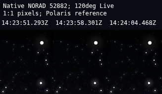
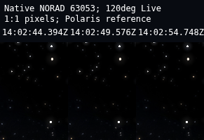

# P0 native satellite recovery — 2026-10-26

**Native unselected Live satellite light-point motion is observed. PR107 remains BLOCKED for owner acceptance and the existing release gates.** The confirmed new product defect was the Hub drawer covering its Stop tracking action; it is repaired. No native rendering/propagation/photometry patch or brightness change was justified or made.

Branch: `recovery/reconcile-20261026`. Tested correction: `ab861073c62bbbf82b9e4f214389931b6ebe2f9f`. The later report commit changes evidence/context only. Starting application was `6282d71deca9e2a339479f67be1f7794cd673180`; the only application change is the scoped selected-drawer CSS rule. No new branch/PR, merge, deployment, provider acquisition, protected data replacement or volume operation.

## Actual cause and correction

The initial preview containers had stopped during a host restart, and the task feed under `/tmp` was absent. Restored the exact archived first-party artifact (artifact 12630695024, ZIP SHA `a1b0522e2a1eeb3b8be4b787dd7f4a744668aca7f3fda446821206d94f1f318d`) to its absent task mount and started only the two existing recovery containers. Original data was not substituted. Native/API share release SHA `902387afd7a0b268c16bbe0303c9706873a2031dccd2eaaeb6668cca90575a21` and count 15,901. Acquisition was 05:43 UTC, not the restoration time. At the P0 captures 15,900 records were within 14 days and one had aged out; the API/UI correctly show mixed/stale data. Each admitted moving-point measurement has its own fresh TLE epoch/age in the receipt.

The earlier 9.2-magnitude observation did not demonstrate a renderer defect. The CelesTrak 3LE release contains orbital elements but no standard magnitudes. The unchanged upstream satellite constructor uses standard magnitude 7 when omitted, then applies its native range/phase/shadow model. This is a native estimate, not measured satellite brightness. At 120 degrees, the captured display settings and darkest permissible native adaptation imply upper point limits around 7.26 desktop and 5.75 mobile; magnitude 9.2 yields native unconstrained radii about 0.094/0.044 pixels, below the 0.25 skip threshold. Actual brighter backgrounds can further reduce eligibility. No fabricated brightness enrichment was added.

The upstream renderer discovers 32 previously unflagged satellites per animation frame. A complete 15,901-record discovery sweep requires 498 frames. Measured software-browser waits varied roughly 15–45 seconds; this is a real initial-discovery delay at this catalog scale, not stopped orbital propagation. Once admitted, visible objects are updated/rendered each frame. This work records the limitation and does not silently increase its native frame budget.

A real pointer selected a moving point and successfully established its native lock. Stop tracking in the selected-object drawer was then covered by the drawer handle: fixed 72 px height plus wrapped actions and scrolling placed the button under the handle. `elementFromPoint` returned `ws-drawer-handle`; the real click timed out. The correction sets the collapsed Sky drawer to `height:auto;min-height:72px`, so content determines height. The regression now hits the actual Stop button and releases the native lock without changing Live mode, observer or FOV. The separate time-bar Stop action was not claimed broken.

## Visual evidence

All natural-motion frames use ordinary `/sky-engine` without a historical date, current Live UTC/native 1x, source-qualified ORAS observer 41.321903,-79.585394,432.816 m,120 degree FOV, fixed camera, no selection and no lock. Native satellites/hints are enabled with offset 2. The existing atmosphere-off, exposure 2.5, star-scale 1 preference is retained. These captures therefore prove the application display, not naked-eye daylight visibility.

| Evidence | Result |
|---|---|
| Desktop, committed correction | 10:23:51–10:24:04 EDT (14:23:51–14:24:04UTC), native point 52882 moved 46.48px. Polaris moved 0.00000px. Projection residuals 0.44px or less for this point. |
| Mobile positive observation | 10:02:44–10:02:54 EDT, native point 63053 moved 38.07px; Polaris moved 0.00000px. Its TLE was 0.844days old. This precedes the drawer-only fix; native payload/build, source feed, observer, camera and display settings match the final run. |
| Later committed mobile run | 10:24:38–10:24:48 EDT: **NO_NATIVE_POINT_MOTION_PROOF**, command exits 2. Brightest modeled object was outside the left edge; in-view candidates began near 5.58 mag.52297 produced isolated point pixels only near the end, leaving no first-frame centroid. Not relabeled as a pass. |
| Point/hint separation | After natural motion, a separate frozen-current-epoch diagnostic hides hints, then the native satellite layer. The point-only difference retains white pixels with zero green symbol pixels. This diagnostic is not used to manufacture the natural-motion frames. |
| Original native comparison | Original lock-matched WASM SHA54651299e35a47c342ba3364be6b77f1ee8b40926d925e7736d05e566c0dfa09, pin023e3b26. Identical15901-record feed, observer, current epoch, FOV/camera, visibility/hint and display settings in desktop/mobile. Seven satellite coordinates match at returned precision; magnitude differences < 4.4e-9. Native JSON UTC roundtrip tolerance 8.64 microseconds is explicit. |

Contact sheets are lossless 1:1 crops from three actual rendered frames, with captions outside the scene. No invented points, position overlays, brightness adjustment or simulation. Full PNG frames and intermediate failed diagnostic attempts remain locally under `output/playwright/p0-native-satellites/`. [Crop identities](receipts/desktop-contact-source.json), [mobile identities](receipts/mobile-contact-source.json), [adjudication](receipts/visual-adjudication.json), [final run](receipts/committed-live-proof.json.gz), [earlier mobile run](receipts/earlier-live-proof.json.gz), [original comparison](receipts/original-reference-proof.json).

The original satellite, core point/tone/projection, telescope and mouse-input sources match the pin byte-for-byte ([source hashes](receipts/native-source-identity.json)). The Hub retains its previously qualified landscape hook; the original WASM and current Hub WASM are deliberately distinguished. This is a native-engine comparison, not a claim of complete upstream website UI parity.

## Focused qualification

- Docker satellite API/release pipeline: 24 passed, 2 deprecation warnings.
- Frontend at committed correction: 384 passed across 58 files; typecheck passes. Earlier focused run: 66 passed.
- Native presentation/tracking contracts: 14 passed, no failures/skips, using explicit in-process Node test isolation. The default runner initially reported only two file-level passes; that is not substituted for the 14 named tests.
- Source admission parser: 5 passed.
- Hub production build passes with the existing >500kB chunk warning. Updated only the isolated preview's Hub entry/assets, retaining old files for rollback. Every native Sky payload byte compared equal before update. No Sky rebuild was needed because no Sky source/generated/native input changed.
- Current Sky search/Focus/details/observing tools: 3 viewport journeys passed (1440x900,390x900,667x390).
- Selected-satellite Track/Stop regression: red real-pointer interception, then 3 green viewport journeys. Focused layout setup selects a real source-backed native object through SWE; the independent natural-motion run additionally proves desktop real moving-point pointer selection/Track/Stop. Mobile moving-point tap was not freshly qualified in the final low-signal interval.
- No page errors in the natural motion runs. Historical dense-star resource404s remain an existing limitation, not fixed here.

Failed attempts are retained: timestamp serialization strict-equality mismatch, screenshot/native-state timing and minimum-contrast diagnostics, zero-duration native mouse-down, drawer interception and a mobile test race with the automatically opening selection sheet. The final validators synchronize canvas sampling to native animation frames, require source-qualified orbits/projected centroid agreement/fixed-star controls, and return 2 for an unproven interval.

## Remaining limits and next task

Ordinary native points work during eligible passages, with visibly weaker mobile contrast and no guarantee for an arbitrary view/time. Unknown standard magnitudes, one aged-out orbital record, native initial-discovery latency, practical owner UX acceptance and physical-device/Windows GPU qualification remain. The earlier mobile positive result is explicitly scoped to the identical native path; it is not a blanket pass for the later interval or hardware. Do not mark the entire product accepted.

PR107 remains a blocked draft because owner/device acceptance, security/advisory disposition, independent review, source-offer/build-completeness and the other previously recorded release gates remain outside this bounded P0. Next bounded decision: owner review of these real captures/preview, then determine whether qualified published photometric metadata or an explicitly identified native-indicator UX is required. Do not lower magnitudes or disguise indicators as naturally visible objects.

## Files, commands and authority

Application change: `frontend/src/features/workspace/skyCinematic.css`. Added validators: `scripts/validation/verify_native_satellite_live_pixels.mjs`, `compare_native_satellite_reference.mjs`, `verify_satellite_tracking_controls.mjs`. Additional changes are this evidence package and the linked live/state/recovery checkpoints. [Exact changed paths](CHANGED_FILES.txt). No removed native scientific logic.

Default Mode with the owner's explicit narrowed P0 continuation. Loaded root/scoped frontend AGENTS, CORE_CONTEXT, owner and recovery LIVE_SESSION_BRIEF, CONTEXT_MANIFEST, SYSTEM_VALIDATION_SPEC, UNIFIED_UNIVERSE_ARCHITECTURE and relevant existing recovery/native-satellite receipts. Older phase restrictions were surfaced as superseded by the explicit continuation; no broad docs scan or repository re-audit. Skills: using-superpowers, systematic-debugging, Playwright, test-driven-development and verification-before-completion. Preservation rules remain in force.

Exact commands/results: [COMMANDS.md](COMMANDS.md). Full native capture metadata is losslessly gzip-preserved, with original byte hashes in `receipts/capture-compression.json`; read using `gzip -cd`. Raw selected logs are gzip-preserved under [receipts](receipts/). [Preservation comparison](receipts/preservation.json): 141 protected containers unchanged; no new containers, 90 volumes present, owner settings/legacy catalog hashes unchanged, task mounts read-only and native WASM unchanged. No merge/deletion/protection approval is requested by this P0 handoff.
