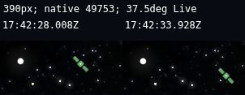
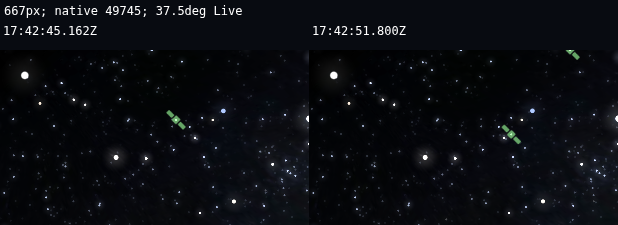

# P0 satellite usability finalization — 2026-10-26

**Mobile touch interaction is qualified in software; owner acceptance is still required. PR #107 remains blocked for integration. No further satellite renderer rework is recommended from this run. Next priority: independent integration review, then the owner-rejected Earth, Solar and shared UX.**

Branch `recovery/reconcile-20261026`, starting SHA `3f094ba05fe0855d5766a96cb1694b83ffc73a1a`. Tested application correction: `5ef2b8a52c6542f18ff616481439598c6140d7bf`. Subsequent changes are validation options/evidence/context; application source remains identical to that tested revision. No new PR, branch, merge, deployment, catalog acquisition, dependency migration or protected-data replacement.

## Corrections actually shipped

- **Hidden data availability / misleading whole-catalog impression:** fresh data previously produced no badge, while a mixed catalog showed only “Stale data.” Existing Sky status now says **Satellite data** when fresh and **Mixed ages** when fresh and stale records coexist. Existing details retain exact counts and selected-element age. These are data states, never claims that satellites are visibly eligible.
- **Missing ordinary-observing guidance:** the existing time/data details explain faintness, eclipse, horizon/view limits and estimated brightness, then describe normal native zoom, tap, Track and Stop. Symbols are explicitly identification aids. No additional panel, Passes workflow or simulation was added. Guidance was actually scrolled into view at all three viewport sizes.
- **Confirmed public information disclosure, CodeQL #79:** service-level validation errors were caught and copied as raw exception strings into public HTTP 200/degraded `data.reason`, bypassing the prior route 400 guard. Both validation and parser failures now return application-owned fixed reasons. Status, counts, provenance, cache and selected-object semantics remain. Three private exception classes failed before correction and passed afterward; private nonnumeric configuration is also not reflected. Independent boundary and fresh bypass/compatibility reviews found no concrete surviving path. This is a focused fix, not an exhaustive security audit.

No new native rendering, orbital, photometric, hint, exposure or touch-target adjustment was necessary. The earlier Stop tracking drawer correction remains intact. All measured Stop buttons are at least 44 px high.

## Current-code browser results

All natural captures use the normal `/sky-engine` route, actual Live UTC/native 1× and the qualified ORAS observer. No object is selected or tracked during motion capture. Mobile uses a **real two-finger pinch from 120° to 37.5°**: this qualifies normal zoomed observing, not guaranteed visibility in the default wide view. Camera/FOV are identical across the recorded motion frames. Point-only isolation is a separate frozen-current-epoch diagnostic; it does not manufacture the natural-motion frames.

| Layout | Current evidence | Result |
|---|---|---|
| Portrait 390×900 | 13:42:28–13:42:33 EDT; NORAD 49753; native magnitude 5.966; TLE age 0.793 days; 31.62 px motion, Polaris 0 px | Real touch selects the moving object; Track establishes native lock; Stop releases it; Deselect returns to unselected, unlocked, Live free observing. Observer/FOV preserved. |
| Landscape 667×390 | 13:42:45–13:42:51 EDT; NORAD 49745; native magnitude 6.458; TLE age 1.643 days; 22.03 px motion, Polaris 0.00015 px | Same complete real-touch path passes. Stop button 101.875×44 px; no obstruction in tested controls. |
| Desktop 1440×900 | Current native selection/Track/Stop/layout and reachable guidance pass. Current ordinary and wheel-zoom capture attempts remain rejected by guards. | Default candidate failed point-only isolation. Wheel-zoom produced isolated native point pixels and 25.81 px displacement, but the first frame had no catalog-backed Polaris reference; no complete new desktop motion pass is claimed. Earlier desktop proof is reused only for the unchanged native payload. |

These are 1:1 lossless crops of actual native canvas frames, without brightness adjustment or artificial points. Full frames remain under `output/playwright/p0-satellite-finalization/`. [Qualified mobile measurements](receipts/qualified-mobile-summary.json), [all usability outcomes](receipts/live-usability.json.gz), [desktop failed guard](receipts/desktop-guarded-capture.json), [layout controls](receipts/tracking-layout.json), [reachable guidance](receipts/guidance-reachable.json).

The previously failed wide-mobile capture is not a renderer defect: NORAD 52297 changed from 5.744→5.710→5.679 mag and produced detectable point pixels only in the final frame. The full discovery sweep had already been allowed. The resulting missing initial centroid is a timing/near-threshold visibility limitation; it remains unsuccessful evidence. Current successful mobile observations are separately dated above and use native zoom, with no altered magnitudes.

## Discovery delay: measured limitation, preserved tradeoff

The 32-object native batch remains unchanged. It bounds work while an already-admitted object updates every frame. A complete 15901-object sweep still requires up to 498 frames; that is not the same measurement as time to the first visible satellite.

A bounded source-projected pixel probe recorded candidate acquisition between approximately 1.6 and 24 seconds. It combines discovery, view and changing photometric eligibility, so it is **not** a controlled scheduler-only latency result or a speedup claim. A separate 3-second phase with no image reads measured about 20.5/33.5/37.5 fps for desktop/portrait/landscape, with p95 frame intervals 133/50/50 ms. This is SwiftShader evidence, not physical-GPU performance. Raw data: [discovery probe](receipts/discovery-probe.json).

No safe native acceleration was qualified. The software renderer already shows substantial frame-time variation, and no isolated evidence justified increasing per-frame scientific work or changing upstream code. The original bounded tradeoff is retained; **discovery speed improvement: none claimed**. The implemented improvement is honest status/guidance and demonstrated native mobile interaction. Invalid early measurement attempts caused by diagnostic observer-update overhead or API decoding were excluded, not reported as app latency.

## Qualification and preservation

- Final application: 386 frontend tests / 58 files, typecheck and Hub production build pass; existing >500kB chunk warning remains.
- Docker satellite API/release suite: 28 passed, 2 dependency deprecation warnings. Security trigger: 3 red cases before fix; 28 green owning tests afterward, including valid/corrupt/missing/configured releases and nonreflection of private diagnostics.
- Native presentation/tracking contracts: 14 passed; source parser: 5 passed.
- Current native Track/Stop control regression: 3 viewport journeys pass. Guidance is reachable in all 3 viewports.
- Cross-mode navigation: 10 surfaces observed across desktop/portrait Sky, Earth, Solar, Earth planetary system and native Moon routes, with no page errors. Existing dense-star tile 404s remain known. This is navigation regression evidence, not acceptance of those experiences.
- Current mobile real moving-point interaction: 2 pass. Current desktop complete point-motion qualification: unproven as recorded above. No unsuccessful capture was relabeled.
- 141 protected containers unchanged; 90 volumes remain; no new containers. Owner dirty settings, legacy catalog and native WASM hash remain unchanged. Only the existing task backend was restarted to load the fix, and task Hub build assets were refreshed. Mounted source data stays read-only; native generated Sky files compare byte-for-byte unchanged. [Preservation](receipts/preservation.json), [served Hub hashes](receipts/served-hub-update.json).

The feed was not reacquired. The same 15901-record release remains mounted; one record had aged out in the captured snapshot, while the tested satellites have individually current elements. Missing measured standard magnitudes and native-default brightness estimates remain limitations. No claim of real-world naked-eye daytime visibility is made; the retained native atmosphere-off display preference is explicit in the raw evidence.

## Remaining gates and stop point

Owner UX acceptance and physical mobile/Windows GPU qualification remain open. Integration still requires independent review, dependency/security-advisory disposition and the previously recorded source-offer/build-completeness gates. The specific exception disclosure is repaired with code and regression evidence; final hosted analysis/thread status is recorded in PR #107.

Native propagation/photometry parity and earlier desktop motion are reused from the preceding P0 qualification; neither was re-audited. No new native defect was demonstrated. Stop reworking satellite rendering under this assignment. Proceed next to the separately bounded independent integration review, followed by Earth/Solar/shared UX work under owner direction.

Default context loaded: repository/scoped AGENTS, CORE_CONTEXT, LIVE_SESSION_BRIEF, manifest, SYSTEM_VALIDATION_SPEC, unified architecture and relevant recovery/satellite receipts; the owner’s explicit narrowed task governs current execution. No 85-branch inventory, full repository audit, new licensing work or unrelated feature work. Skills used: systematic-debugging, Playwright, regression-first implementation, fix-finding and verification-before-completion. The security skill required one independent static investigator and one fresh patch reviewer; neither altered code.

[Exact commands](COMMANDS.md) · [changed files](CHANGED_FILES.txt) · [receipts](receipts/).
